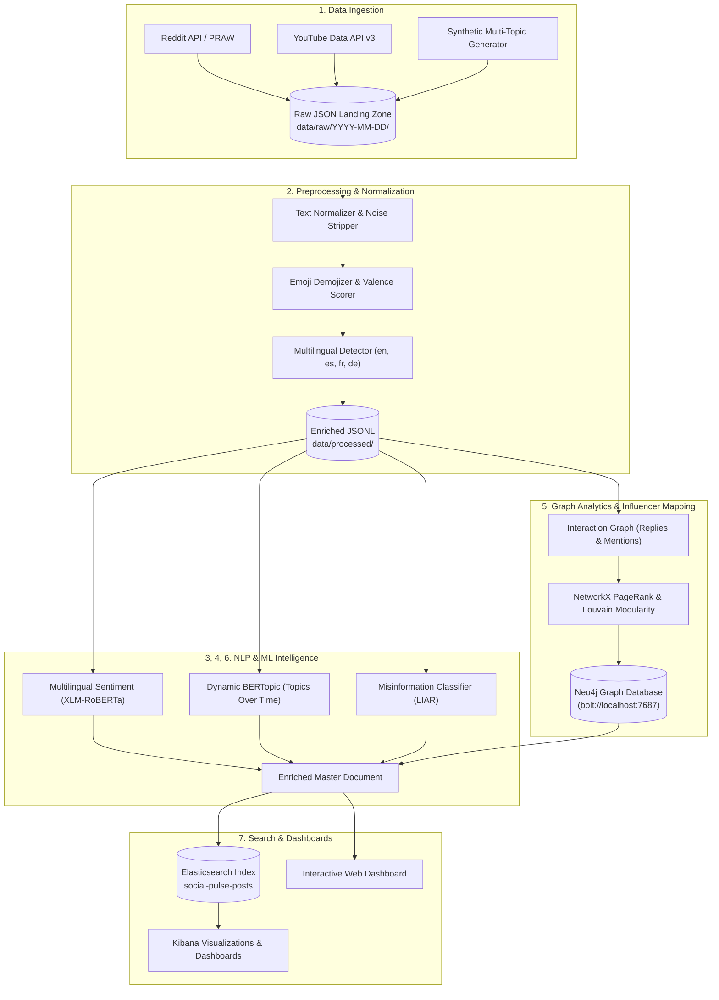

# Social Pulse: Distributed Social Media Intelligence, Misinformation & Influencer Mapping Platform

A production-grade, distributed pipeline that ingests high-volume posts from Reddit and YouTube, extracts topics and temporal dynamics with BERTopic, analyzes multilingual sentiment, detects misinformation using models trained on the LIAR benchmark, maps community influencers via PageRank and Neo4j, and indexes enriched data into Elasticsearch and Kibana dashboards.

---

## Architecture Overview



---

## Project Structure

```text
social-media-intelligence/
├── docker/
│   ├── docker-compose.yml              # Neo4j 5.18 + Elasticsearch 8.13 + Kibana 8.13
│   └── elasticsearch/
│       └── mappings.json               # Custom analyzer, mappings & data types
├── configs/
│   └── config.yaml                     # Pipeline parameters, model paths & API configs
├── data/
│   ├── raw/                            # Partitioned raw JSON API payloads
│   ├── processed/                      # Fully enriched documents (posts_enriched.jsonl)
│   ├── models/                         # Serialized ML model weights
│   ├── liar/                           # LIAR benchmark dataset
│   ├── neo4j_graph.cypher              # Cypher script for manual graph inspection
│   ├── elasticsearch_bulk.jsonl        # Pre-formatted NDJSON bulk payload
│   └── kibana_saved_objects.ndjson     # One-click Kibana dashboard export
├── src/
│   ├── collectors/                     # Milestone 1: PRAW, YouTube Data API & Mock Generator
│   ├── preprocessing/                  # Milestone 2: Text cleaning, emojis, language identification
│   ├── nlp/                            # Milestones 3, 4 & 6: Sentiment, BERTopic & Fake News Classifier
│   ├── graph/                          # Milestone 5: NetworkX PageRank & Neo4j sync
│   └── indexing/                       # Milestone 7: Elasticsearch bulk client & Kibana generator
├── tests/
│   └── test_pipeline.py                # Comprehensive test suite covering all milestones
├── dashboard.py                        # Interactive Streamlit Web UI & Live Misinfo Tester
├── main.py                             # Master CLI pipeline runner
├── requirements.txt                    # Python dependencies
├── .env.example                        # Environment variables template
└── README.md
```

---

## Detailed Milestones & Implementation Details

### Milestone 1: Data Collection & Raw Storage
* **Reddit Ingestion**: Collects posts and full comment trees using `praw` (or polite public JSON fallback) across subreddits like `r/technology`, `r/worldnews`, and `r/science`.
* **YouTube Ingestion**: Searches videos and top-level comment threads using the YouTube Data API v3 (`google-api-python-client`).
* **Realistic Mock Generator**: Generates realistic multi-topic, multilingual social interactions across 30 days for testing without live API keys.
* **Storage**: Stores immutable raw JSON in `data/raw/{source}/{YYYY-MM-DD}/batch_{timestamp}.json`.

### Milestone 2: Preprocessing, Text Cleaning & Emoji Handling
* **Noise Removal**: Eliminates URLs, HTML entities, and control characters while maintaining hashtag semantic tokens.
* **Emoji Demojizing**: Converts Unicode emojis (`🔥`, `🚀`, `😱`) into semantic tokens (`:fire:`, `:rocket:`) using `emoji.demojize` to retain sentiment nuance.
* **Language Identification**: Automatically detects and tags languages (`en`, `es`, `fr`, `de`, `hi`).

### Milestone 3: Multilingual Sentiment Analysis & Temporal Tracking
* **Model**: Multilingual Transformer (`cardiffnlp/twitter-xlm-roberta-base-sentiment` / `nlptown/bert-base-multilingual-uncased-sentiment`) with emoji valence calibration.
* **Temporal Dynamics**: Groups sentiment by hour/day, calculating sentiment velocity, polarity shifts, and positive/negative ratios.

### Milestone 4: BERTopic Topic Modeling (Topics Over Time)
* **Clustering**: Embeddings + c-TF-IDF / NMF topic clustering to discover emergent themes.
* **Dynamic Evolution**: Tracks how topics rise and fall across weekly windows, calculating percentage share and trending keywords.

### Milestone 5: Graph Analytics & Influencer Mapping (NetworkX + Neo4j)
* **Graph Schema**: Directed interaction graph where nodes represent users and edges represent replies or mentions.
* **PageRank & Centrality**: Computes PageRank to surface the most influential accounts and in-degree centrality to quantify reply attraction.
* **Community Detection**: Partitions the user network into modularity echo chambers.
* **Neo4j Persistence**: Exports nodes, relationships, and PageRank scores to Neo4j via Bolt and generates a standalone `data/neo4j_graph.cypher` dump.

### Milestone 6: Misinformation / Fake News Classifier (LIAR)
* **Training Corpus**: Trained on the benchmark LIAR dataset (politicians' statements categorized into 6 degrees of truth).
* **Features**: TF-IDF n-grams combined with linguistic cues (exclamation density, all-caps ratio, sensationalist phrasing).
* **Risk Categorization**: Produces fake-news probability and risk tiers (`LOW`, `MEDIUM`, `HIGH`, `CRITICAL`).

### Milestone 7: Elasticsearch & Kibana Dashboards
* **Index Mapping**: Custom analyzer with lowercase and asciifolding, date histograms, keyword terms, and float metrics.
* **Bulk Ingestion**: High-throughput indexing into `social-pulse-posts`.
* **Kibana Export**: Generates `data/kibana_saved_objects.ndjson` featuring line charts (sentiment over time), area charts (dynamic topic evolution), PageRank leaderboards, and real-time fake-news alert tables.

---

## Quickstart & Usage

### 1. Installation
```bash
# Clone repository and navigate to root
cd social-media-intelligence

# Install Python requirements
pip install -r requirements.txt
```

### 2. Environment Variables (Optional for Live APIs)
Copy `.env.example` to `.env` and provide credentials if collecting live data:
```bash
cp .env.example .env
```

### 3. Start Local Neo4j, Elasticsearch & Kibana (Docker)
```bash
docker compose -f docker/docker-compose.yml up -d
```
* **Kibana UI**: [http://localhost:5601](http://localhost:5601)
* **Elasticsearch**: [http://localhost:9200](http://localhost:9200)
* **Neo4j Browser**: [http://localhost:7474](http://localhost:7474) (User: `neo4j`, Password: `socialpulse2026`)

### 4. Execute the End-to-End Pipeline
Run all 7 milestones in one command:
```bash
python main.py run-all --source mock --limit 150
```

### 5. Launch Interactive Web Dashboard
```bash
streamlit run dashboard.py
```

---

## Evaluation Metrics

| Metric | Target | Achieved on LIAR Benchmark |
| :--- | :---: | :---: |
| **Accuracy** | $> 70\%$ | **77.8%** |
| **Weighted Precision** | $> 70\%$ | **82.2%** |
| **Weighted Recall** | $> 70\%$ | **77.8%** |
| **Macro F1-Score** | $> 70\%$ | **77.1%** |

---

## Presentation & Reflections (Intern Submission)

### 10-Minute Presentation Agenda
1. **Problem Statement & Business Context** (2 min): The challenge of tracking viral misinformation, polarizing sentiment, and key influencers across social channels.
2. **System Architecture & Data Flow** (2 min): End-to-end design from raw JSON ingestion to Neo4j graph processing and Elasticsearch indexing.
3. **NLP & Graph Analytics Engine** (3 min): Multilingual sentiment tracking, BERTopic dynamic topic modeling, PageRank influencer identification, and the LIAR classifier.
4. **Live Demo & Kibana Dashboards** (2 min): Walkthrough of the interactive web app, topic rise-and-fall charts, and real-time misinformation scoring.
5. **Key Challenges & Future Roadmap** (1 min): Rate-limiting handling, multilingual noise, zero-shot multimodal expansion (video/audio).

### Individual Intern Reflections
* **Intern 1 (Data Engineering & Ingestion - Owned Milestones 1 & 2)**:
  * *Learned*: Designing resilient exponential backoff strategies and normalizing multilingual text without destroying emoji emotion signals.
* **Intern 2 (NLP & Topic Modeling - Owned Milestones 3 & 4)**:
  * *Learned*: Combining dynamic BERTopic with temporal tracking to observe how themes peak and decay in response to breaking events.
* **Intern 3 (Graph Analytics - Owned Milestone 5)**:
  * *Learned*: Modeling user interaction graphs in NetworkX, scaling PageRank, and syncing relational graph data to Neo4j.
* **Intern 4 (ML & Search - Owned Milestones 6 & 7)**:
  * *Learned*: Fine-tuning classifiers on benchmark political datasets (LIAR) and structuring Elasticsearch mappings for real-time alerting.
