# Causal Inference & A/B Experimentation Platform

An end-to-end internal experimentation platform designed to calculate statistical power, analyze frequentist and Bayesian A/B tests with peeking-safe sequential testing, and infer causal treatment effects from observational data using Propensity Score Matching (PSM), Difference-in-Differences (DiD), and Synthetic Control (SCM).

---

## 1. System Architecture

```mermaid
flowchart TD
    subgraph Client_Layer ["Client & Visualization Layer"]
        WebUI["Interactive Dashboard (FastAPI / Tailwind / Chart.js)"]
        ReactApp["React 18 Single-Page Application (frontend/)"]
        PlainEnglish["Plain-English Decision Explainer"]
        WebUI --> PlainEnglish
        ReactApp --> PlainEnglish
    end

    subgraph Service_Layer ["FastAPI Service Layer (/api/v1)"]
        Router["Application Gateway"]
        PowerEndpoint["/power (Sample size & MDE curves)"]
        FreqEndpoint["/frequentist (t-test, Chi-sq, FDR)"]
        SeqEndpoint["/sequential (mSPRT & Alpha spending)"]
        BayesEndpoint["/bayesian (Beta-Binomial & Loss)"]
        CausalEndpoint["/causal (PSM, DiD, SCM)"]
        Router --> PowerEndpoint
        Router --> FreqEndpoint
        Router --> SeqEndpoint
        Router --> BayesEndpoint
        Router --> CausalEndpoint
    end

    subgraph Core_Engines ["Statistical & Causal Computation Core"]
        PowerCalc["PowerCalculator (Statsmodels / NormalIndPower)"]
        FreqEngine["FrequentistEngine (Welch t-test, Chi-sq, Benjamini-Hochberg)"]
        SeqEngine["SequentialEngine (mSPRT likelihood ratio, Lan-DeMets)"]
        BayesEngine["BayesianABEngine (Beta-Binomial conjugate, Monte Carlo, ROPE)"]
        CausalEngine["ObservationalCausalEngine (DoWhy refutations, SLSQP convex optimization)"]
    end

    subgraph Benchmarks ["Bundled Benchmark Datasets"]
        CookieCats["Cookie Cats Mobile Game (Retention A/B)"]
        CardKrueger["Card & Krueger 1994 (Difference-in-Differences)"]
        LaLonde["LaLonde NSW Job Training (PSM)"]
        Prop99["California Prop 99 (Synthetic Control)"]
    end

    WebUI --> Router
    ReactApp --> Router
    PowerEndpoint --> PowerCalc
    FreqEndpoint --> FreqEngine
    SeqEndpoint --> SeqEngine
    BayesEndpoint --> BayesEngine
    CausalEndpoint --> CausalEngine
    FreqEngine -.-> CookieCats
    CausalEngine -.-> CardKrueger
    CausalEngine -.-> LaLonde
    CausalEngine -.-> Prop99
```



---

## 2. Detailed Milestone Specifications

### Milestones 1 & 2: Power and Sample Size Calculator
* **Proportions**: Exact two-sample sample size calculation under pooled $H_0$ and unpooled $H_1$ variances:
  $$n_1 = \left( \frac{Z_{1 - \alpha/2}\sqrt{\bar{p}(1-\bar{p})(1 + 1/r)} + Z_{1 - \beta}\sqrt{p_1(1-p_1) + p_2(1-p_2)/r}}{\delta} \right)^2$$
* **Continuous**: Cohen's $d$ effect size and Student's $t$ power calculation via `statsmodels.stats.power.TTestIndPower`.
* **MDE Sensitivity Curves**: Interactive sensitivity curve generation mapping total sample sizes to detectable effect limits.

### Milestone 3: Frequentist Hypothesis Testing & FDR Corrections
* **Continuous Outcomes**: Two-sample Welch's unequal variance $t$-test with Satterthwaite degrees of freedom.
* **Conversion Rates**: $\chi^2$ test of independence with Yates continuity correction and 95% Wald confidence intervals.
* **Multiple Testing Adjustments**:
  * **Bonferroni**: Controls Family-Wise Error Rate ($\alpha' = \alpha / m$).
  * **Benjamini-Hochberg (BH)**: Controls False Discovery Rate (FDR) by ranking p-values $P_{(1)} \le \dots \le P_{(m)}$ and identifying critical rank $k$.
* **Benchmark**: Cookie Cats mobile game 7-day retention and total game rounds played.

### Milestone 4: Safe Sequential Testing (Peeking Protection)
* **The Peeking Problem**: Checking traditional p-values continuously inflates false-positive rates from 5% to 30%+.
* **Mixture Sequential Probability Ratio Test (mSPRT)**:
  * Uses a Gaussian mixture prior over effect size $\tau$:
    $$\Lambda_n = \sqrt{\frac{V_n}{V_n + n\tau^2}} \exp\left( \frac{\tau^2 S_n^2}{2 V_n (V_n + n\tau^2)} \right)$$
  * Allows early stopping anytime $\Lambda_n \ge 1 / \alpha$ with guaranteed Type I error protection.
* **Alpha Spending (Lan-DeMets)**:
  * O'Brien-Fleming conservative early boundaries preserving statistical power for scheduled interim looks.

### Milestone 5: Bayesian A/B Testing
* **Beta-Binomial Conjugate Model**:
  $$\text{Prior } \text{Beta}(1, 1) \longrightarrow \text{Posterior } \text{Beta}(\alpha_0 + k, \beta_0 + n - k)$$
* **Metrics Computed**:
  * **$P(\text{Variant B} > \text{Variant A})$**: Exact posterior probability via Monte Carlo integration ($N = 100,000$).
  * **Expected Loss**: $\mathbb{E}[\max(0, \theta_A - \theta_B)]$.
  * **95% Highest Density Interval (HDI)** for relative lift.
  * **ROPE (Region of Practical Equivalence)** decision rules.

### Milestone 6: Observational Causal Inference (DoWhy & EconML)
1. **Propensity Score Matching (PSM)**:
   * Logistic regression estimation of $e(X) = P(T=1 \mid X)$.
   * 1:1 Nearest-Neighbor matching with caliper restriction.
   * Covariate balance assessment via Standardized Mean Differences ($\text{SMD} < 0.10$).
   * DoWhy 4-step framework validation with random common cause refutations on the **LaLonde NSW** dataset.
2. **Difference-in-Differences (DiD)**:
   * Two-way fixed effects / OLS regression: $Y_{it} = \beta_0 + \beta_1 \text{Treated}_i + \beta_2 \text{Post}_t + \delta(\text{Treated}_i \times \text{Post}_t) + \epsilon_{it}$.
   * Validated on the **Card & Krueger (1994)** New Jersey vs Pennsylvania fast food employment minimum wage experiment.
3. **Synthetic Control Method (SCM)**:
   * Solves constrained quadratic program $\min_W \| Y_{1,\text{pre}} - Y_{0,\text{pre}} W \|_2^2$ subject to $w_j \ge 0$ and $\sum w_j = 1$.
   * Validated on **California Proposition 99 (1988)** tobacco tax intervention.

### Milestone 7: Plain-English Decision Engine & Web UI
* Automatically translates statistical results into clear business conclusions and next steps:
  > *"Variant outperformed Control with statistical significance (p = 0.0124). Observed relative lift of +9.00% (95% CI: [+1.84%, +16.16%]). Safe to ship variant to 100% of production traffic."*

---

## 3. Quickstart & Usage

### 1. Installation
```bash
cd causal-ab-platform
pip install -r requirements.txt
```

### 2. Run Test Suite
```bash
python run_tests.py
```

### 3. Launch the Platform
```bash
python -m uvicorn backend.app.main:app --host 0.0.0.0 --port 8000 --reload
```
* **Interactive Dashboard**: [http://localhost:8000/](http://localhost:8000/)
* **Swagger API Documentation**: [http://localhost:8000/docs](http://localhost:8000/docs)

---

## 4. Verification Test Results

```text
======================================================================
  CAUSAL & EXPERIMENTATION PLATFORM - VERIFICATION TEST SUITE
======================================================================
  [PASS] Milestones 1 & 2: Power & Sample Size Calculator
  [PASS] Milestone 3: Frequentist Tests & Multiple Correction
  [PASS] Milestone 4: Safe Sequential Testing (mSPRT & Alpha Spending)
  [PASS] Milestone 5: Bayesian A/B Engine (Beta-Binomial & Loss)
  [PASS] Milestone 6: Observational PSM (LaLonde & DoWhy)
  [PASS] Milestone 6: Observational DiD (Card & Krueger 1994)
  [PASS] Milestone 6: Observational SCM (California Prop 99)
  [PASS] Milestone 7: Plain-English Decision Engine
======================================================================
  Results: 8 Passed, 0 Failed
======================================================================
```

---

## 5. Presentation & Reflections (Intern Submission Deliverables)

### 10-Minute Final Presentation Agenda
1. **Problem Statement & Motivation** (2 min): Experimentation traps (underpowered tests, p-hacking via peeking, false discoveries) and the need for observational causal inference when randomization is impossible.
2. **System Architecture & Design** (2 min): FastAPI service architecture, computational statistical engines, and React client.
3. **Statistical Innovations** (3 min): mSPRT peeking protection, Bayesian expected loss decision rules, and DoWhy refutation tests.
4. **Live Product Walkthrough** (2 min): Calculating sample size, evaluating Cookie Cats A/B test, and estimating California Prop 99 synthetic control.
5. **Key Engineering Challenges & Future Vision** (1 min): Covariate balance optimization, multi-armed bandits, and continuous causal discovery.

### Individual Intern Reflections
* **Intern 1 (Power & Frequentist Testing - Owned Milestones 1, 2, 3)**:
  * *Learned*: Deriving analytical power curves under unpooled variances and understanding the exact trade-off between Bonferroni conservative FWER and Benjamini-Hochberg discovery power.
* **Intern 2 (Sequential & Bayesian Inference - Owned Milestones 4 & 5)**:
  * *Learned*: Implementing mixture SPRT likelihood ratios to solve the peeking problem and quantifying risk via Bayesian expected loss rather than arbitrary p-value cutoffs.
* **Intern 3 (Observational Causal Inference - Owned Milestone 6)**:
  * *Learned*: Constructing counterfactuals through constrained optimization (Synthetic Control) and validating assumptions using DoWhy's 4-step framework and placebo refutations.
* **Intern 4 (API Design & Plain-English UI - Owned Milestone 7)**:
  * *Learned*: Designing unified REST endpoints in FastAPI and building the plain-English translation layer that converts raw confidence intervals into actionable executive decisions.
