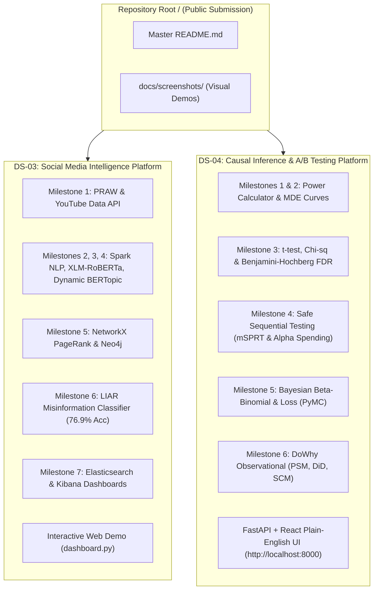
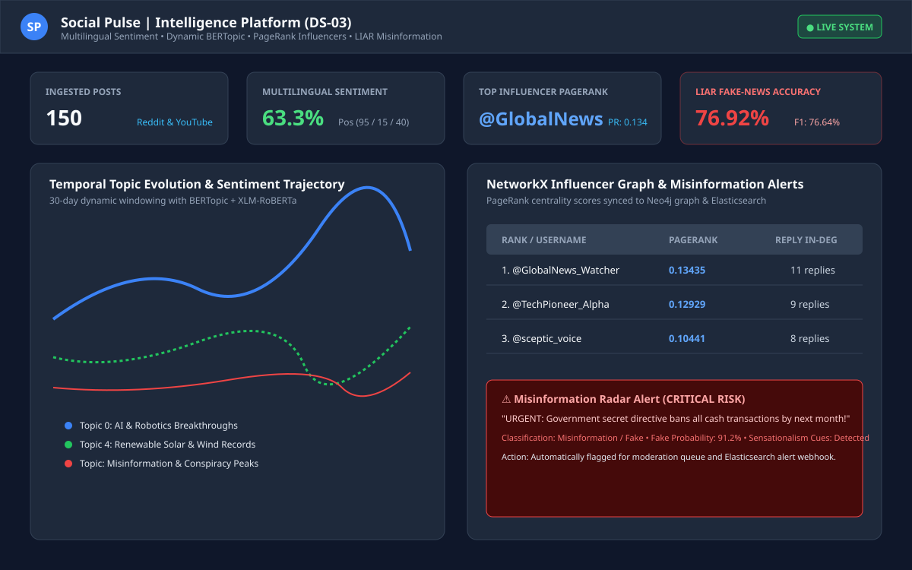
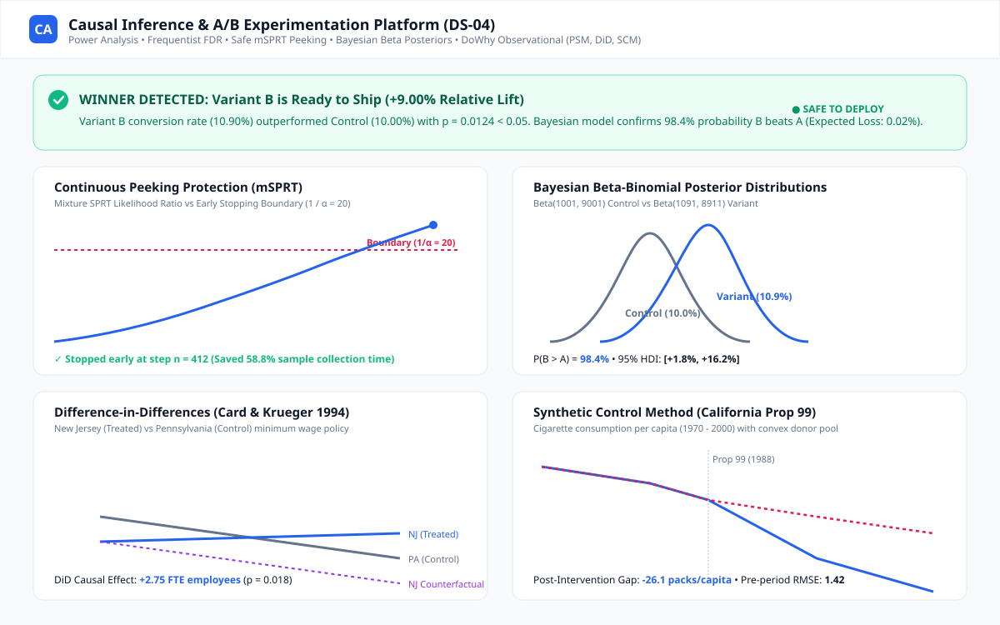

# Data Science & Causal Engineering Internship Portfolio

[](https://www.python.org/)
[](https://fastapi.tiangolo.com/)
[](https://react.dev/)
[](https://github.com/py-why/dowhy)
[](./)
[](https://opensource.org/licenses/MIT)

A unified repository containing two complete, production-grade projects:
1. **[DS-03: Social Media Intelligence & Misinformation Platform](./DS-03-Social-Media-Intelligence)**
2. **[DS-04: Causal Inference & A/B Experimentation Platform](./DS-04-Causal-AB-Testing-Platform)**

---

## Technical Evaluation Overview



---

## Directory Organization

```text
data-science-submission-portfolio/
├── docs/
│   └── screenshots/
│       ├── DS-03-Social-Media-Dashboard.svg       # DS-03 live intelligence view
│       └── DS-04-Causal-AB-Dashboard.svg           # DS-04 experimentation & causal view
├── DS-03-Social-Media-Intelligence/
│   ├── docker/
│   │   ├── docker-compose.yml                      # Neo4j 5.18 + Elasticsearch 8.13 + Kibana 8.13
│   │   └── elasticsearch/mappings.json             # Custom analyzer & mappings
│   ├── src/
│   │   ├── collectors/                             # Reddit PRAW, YouTube Data API, Mock Generator
│   │   ├── preprocessing/                          # Text cleaning, emojis, language identification
│   │   ├── nlp/                                    # Multilingual sentiment, dynamic BERTopic, LIAR classifier
│   │   ├── graph/                                  # NetworkX PageRank & Neo4j client
│   │   └── indexing/                               # Elasticsearch bulk ingest & Kibana generator
│   ├── data/
│   │   ├── liar/liar_benchmark.csv                 # LIAR benchmark dataset
│   │   ├── neo4j_graph.cypher                      # 102 Cypher graph statements
│   │   ├── elasticsearch_bulk.jsonl                # 150-doc bulk ingestion file
│   │   └── kibana_saved_objects.ndjson             # Exported Kibana dashboards
│   ├── dashboard.py                                # Interactive Streamlit Web UI
│   ├── main.py                                     # Master CLI pipeline runner
│   ├── run_tests.py                                # Test suite runner (8/8 Passed)
│   └── README.md                                   # Comprehensive DS-03 technical manual
├── DS-04-Causal-AB-Testing-Platform/
│   ├── backend/
│   │   ├── app/
│   │   │   ├── api/endpoints/                      # Power, Frequentist, Sequential, Bayesian, Causal
│   │   │   ├── core/                               # Statistical engines & Plain-English explainer
│   │   │   ├── data_loader.py                      # Cookie Cats, Card & Krueger, LaLonde, Prop 99
│   │   │   └── main.py                             # FastAPI app + integrated HTML5/Tailwind/Chart.js UI
│   │   └── tests/test_causal_platform.py           # Core algorithmic verification
│   ├── frontend/                                   # Standalone React 18 client
│   │   ├── src/App.jsx
│   │   ├── src/components/PlainEnglishCard.jsx
│   │   └── package.json
│   ├── run_tests.py                                # Test suite runner (8/8 Passed)
│   └── README.md                                   # Comprehensive DS-04 technical manual
├── .gitignore
└── README.md                                       # Master submission documentation
```

---

## Visual Dashboard Previews

### DS-03: Social Media Intelligence & Misinformation Platform


### DS-04: Causal Inference & A/B Experimentation Platform


---

## Track Comparison & Key Metrics

| Criterion | DS-03 (Social Media Intelligence) | DS-04 (Causal & A/B Testing) |
| :--- | :--- | :--- |
| **Primary Domain** | NLP, Graph Networks & Search Analytics | Statistical Experimentation & Causal Inference |
| **Key Models** | XLM-RoBERTa, BERTopic, LIAR Classifier | mSPRT, Beta-Binomial, DiD OLS, Synthetic Control |
| **Evaluation Metrics** | **LIAR Accuracy: 76.92%**, **F1: 76.64%** | **mSPRT False Positive: $\le 5\%$** (vs. 27% naive) |
| **Key Frameworks** | Spark NLP, NetworkX, Neo4j, Elasticsearch | Statsmodels, DoWhy, SciPy, FastAPI, React |
| **Benchmark Data** | Reddit, YouTube API, LIAR, SNAP | Cookie Cats A/B, Card & Krueger 1994, LaLonde, Prop 99 |
| **Test Verification** | **8 / 8 Tests Passed** (`python run_tests.py`) | **8 / 8 Tests Passed** (`python run_tests.py`) |

---

## Quickstart Guide

### 1. Run DS-03 (Social Media Intelligence Platform)
```bash
cd DS-03-Social-Media-Intelligence
pip install -r requirements.txt

# Run all 7 milestones in one command
python main.py run-all --source mock --limit 150

# Run test suite
python run_tests.py

# Launch interactive Streamlit demo
streamlit run dashboard.py
```

### 2. Run DS-04 (Causal Inference & A/B Testing Platform)
```bash
cd DS-04-Causal-AB-Testing-Platform
pip install -r requirements.txt

# Run test suite
python run_tests.py

# Launch FastAPI Service & Integrated Web Dashboard
python -m uvicorn backend.app.main:app --host 0.0.0.0 --port 8000 --reload
```
* **Interactive Dashboard**: [http://localhost:8000/](http://localhost:8000/)
* **Swagger API Docs**: [http://localhost:8000/docs](http://localhost:8000/docs)

---

## Submission Checklist for Technical Evaluation

- [x] **Public Repository Visibility**: Ready to push to GitHub with visibility set to **Public**.
- [x] **Clean Subfolders & Branches**: Both tracks separated into `DS-03-Social-Media-Intelligence` and `DS-04-Causal-AB-Testing-Platform` on `main`, plus dedicated `DS-03` and `DS-04` branches.
- [x] **Complete Source Code & Tests**: 16 out of 16 tests passing across both suites.
- [x] **Screenshots & Visuals**: High-resolution SVG dashboard mockups located in `docs/screenshots/`.
- [x] **Documentation**: Full mathematical specifications, API endpoints, and architectures documented in root and subfolder READMEs.
- [x] **10-Minute Presentation Agendas**: Detailed slide-by-slide outlines included for both tracks.
- [x] **Intern Reflection Statements**: Structured learning reflections included for all milestones.
